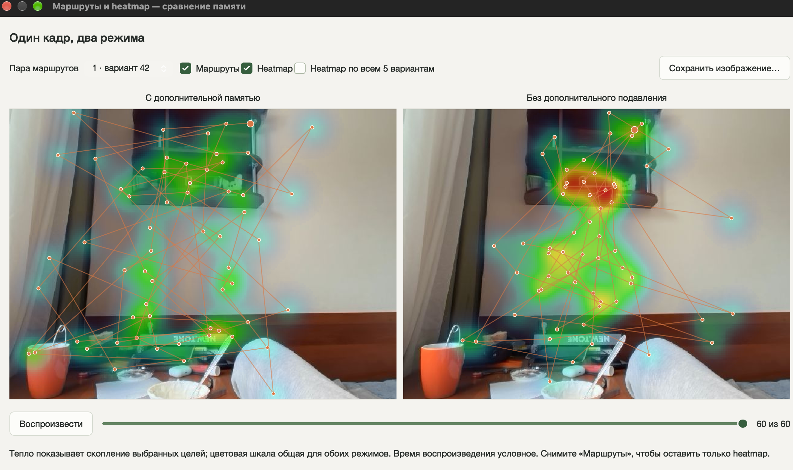
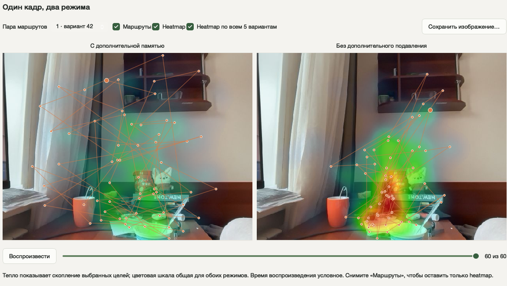
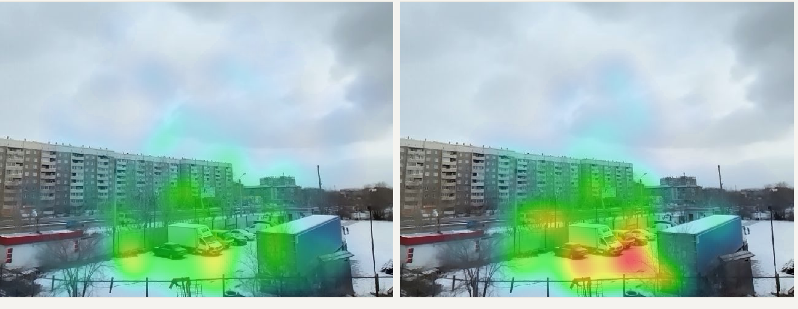

# Моделирование визуального внимания

Исследование последовательного визуального внимания и приложение для сбора траекторий взгляда, прогнозирования внимания по изображениям и экспериментов с камерой.

## Состав

- `project/gaze-mvp/` — приложения на Python/PySide6: сбор через Beam Eye Tracker, просмотр сохранённых траекторий, исходный прототип на Apple Vision и тесты.
- `docs/Merkurev_z_a_human_attention.docx` — текст исследования.
- `docs/human_attention_experiment_colab.ipynb` — эксперимент сравнения DeepGaze IIE, IIE + IOR и DeepGaze III.
- `dataset/PittImageVideoAdsDataset/extract_images.py` — извлечение рекламных изображений из локальных Parquet-файлов.

## Запуск на настроенном Mac

В `project/gaze-mvp/` доступны:

- **Human Attention.command** — единое приложение: камера и виртуальные приводы, прогнозы по фото, просмотр записей, сбор данных и доступ к обучению.
- **Начать сбор.command** — сбор взгляда при просмотре изображений; Beam должен быть включён и откалиброван.
- **Просмотреть записи.command** — просмотр записей, воспроизведение взгляда и сохранение изображений с траекторией, без подключения Beam.
- **Прогноз внимания.command** — демонстрация готовой DeepGaze III на рекламных изображениях, без камеры и Beam; [сценарий показа](project/gaze-mvp/DEMO.md).
- **Экспорт CSV.command** — экспорт сохранённой базы в CSV.

Установка, клавиши управления, формат записей и ограничения описаны в [инструкции приложения](project/gaze-mvp/README.md).

## Эксперименты с памятью и забыванием

Поверх DeepGaze III реализовано дополнительное подавление ранее посещённых областей — Inhibition of Return (IOR). После выбора цели вокруг неё временно снижается вероятность следующего выбора. Подавление постепенно ослабевает, позволяя возвращаться к этой области. Это изменение механизма выбора целей без переобучения DeepGaze.

### Что меняют настройки

| Настройка | При уменьшении | При увеличении |
| --- | --- | --- |
| Сила подавления | Посещённые области слабее штрафуются; при 0 дополнительное подавление отключено | Посещённые области сильнее штрафуются, что может расширять исследование сцены |
| Затухание памяти, с | Быстрее забываются посещения и восстанавливается приоритет области | Посещения сохраняют влияние дольше, возвраты подавляются на больший срок |

Параметр затухания — временная постоянная экспоненты: вклад посещения пропорционален `exp(−возраст / затухание)`. Поэтому значение 4 с не означает полного удаления памяти через четыре секунды: к этому моменту остаётся около 37% начального вклада. Сила задаёт величину начального штрафа, а затухание — скорость его ослабления. Радиус подавления также влияет на результат.

Начальные настройки живого режима: **сила 2, затухание 4 с, минимум между прогнозами 0,8 с**. Интервал ограничивает частоту выбора целей и не является предсказанной длительностью человеческой фиксации.

### Выполненные сравнения силы подавления

На неподвижных кадрах сравнивались маршруты с дополнительной памятью и без дополнительного подавления, в том числе на комнатной и уличной сценах ниже. Каждый режим получает один и тот же кадр; встроенная история DeepGaze включена в обоих. Для парного сравнения используются **5 одинаковых seed, по 60 целей на маршрут**: всего 600 целей для двух режимов. Генерация начинается заново для каждого маршрута. Время для затухания условное — номер шага, умноженный на выбранный интервал.

В режиме «Подобрать силу памяти» предусмотрены **0 / 2,5 / 5 / 8**: без подавления, слабое, среднее и сильное. Это 20 маршрутов, всего 1200 целей. Ползунок в просмотрщике переключает готовые результаты этих уровней, а не пересчитывает промежуточные значения. В обычном сравнении можно проверить выбранную силу, например 2, против 0.

По показанным опытам дополнительное подавление уменьшало немедленные повторы и расширяло пространственное покрытие. В одном из показанных парных опытов сводка была следующей; это результат конкретного кадра и набора маршрутов, а не оценка на всём датасете:

| Показатель, среднее по 5 маршрутам | С дополнительной памятью | Без дополнительного подавления |
| --- | ---: | ---: |
| Возвраты | 21,3% | 40,0% |
| Немедленные повторы рядом | 0,3% | 10,3% |
| Посещённые ячейки из 48 | 27,0 | 21,2 |
| Нормированная пространственная энтропия | 0,808 | 0,707 |

Эта сводка взята из показанного в ходе работы окна результатов. Точная сила и остальные параметры должны браться из соответствующего `report.json`; по одному скриншоту таблицы их восстановить нельзя. Числа не следует приписывать всем приведённым ниже изображениям.

### Как отдельно проверить усиление и ослабление забывчивости

Чтобы исследовать именно скорость забывания, нужно сохранять силу, радиус, кадр, seed, число целей и интервал одинаковыми, меняя только затухание. Например, сравнить **2 / 4 / 8 с при силе 2**: меньшее значение означает более быстрое забывание, большее — более длительное влияние посещений. В текущем интерфейсе это отдельные запуски с изменением настройки; автоматический подбор силы сам по себе затухание не перебирает. Такой ряд является протоколом следующей проверки, а не уже полученным количественным результатом.

Для оценки используются доли возвратов и соседних повторов, покрытие сетки 8×6, нормированная энтропия и длина переходов. Нужно также смотреть маршруты: слишком сильное или длительное подавление может уводить цели на малозначимый фон. Большее разнообразие не доказывает более человеческое поведение. Сравнения следует повторять на разных сценах; движение камеры проверяется отдельно от опыта на стоп-кадре.

Маршруты, параметры и метрики сохраняются в `project/gaze-mvp/collected/attention-comparisons/<сеанс>/report.json`, сводка — в `report.md`, исходный кадр — в `frame.png`. Эти локальные результаты исключены из Git; ниже приведены сохранённые скриншоты.

## Примеры визуализации

Скриншоты экспериментов с DeepGaze III: слева — с дополнительным подавлением ранее посещённых областей, справа — без него. Встроенная история модели используется в обоих режимах. Точки — выбранные моделью цели, а не измеренный взгляд человека.

### Маршруты внимания

Линии соединяют последовательные цели. В просмотрщике можно выбрать маршрут и воспроизвести его по шагам; время анимации условное.



### Облака точек и общая тепловая карта

На этом скриншоте включена heatmap по всем пяти вариантам каждого режима. Линии показывают выбранный маршрут, а тепловая карта объединяет цели пяти маршрутов: это варианты генерации, не пять участников.



### Тепловая карта без линий

При отключённых маршрутах остаётся изображение с heatmap. Цвет показывает относительную плотность выбранных целей, не длительность фиксаций. Внутри каждой пары используется общая цветовая шкала. Более широкое покрытие само по себе не доказывает сходство с человеческим вниманием.



## Локальные данные

Изображения, виртуальные окружения, личные записи взгляда, прогресс, CSV-экспорты и сгенерированные отчёты исключены из Git. Они остаются на диске. После клонирования репозитория нужно установить зависимости и отдельно подготовить исходные данные; Git не является резервной копией записей взгляда.

Приложение ожидает рекламные изображения в `dataset/PittImageVideoAdsDataset/pitt_ads_images/`. База сбора находится в `project/gaze-mvp/collected/p001/`, старые сессии — в `project/gaze-mvp/sessions/`.

## Проверки

Из папки `project/gaze-mvp/` в установленном окружении:

```bash
.venv/bin/python -m unittest discover -s tests -v
```

Автоматические тесты используют синтетические данные и временные папки. Реальные записи и прогресс они не изменяют.
